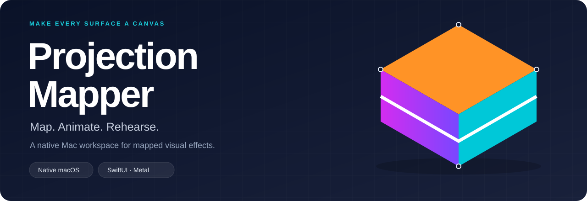
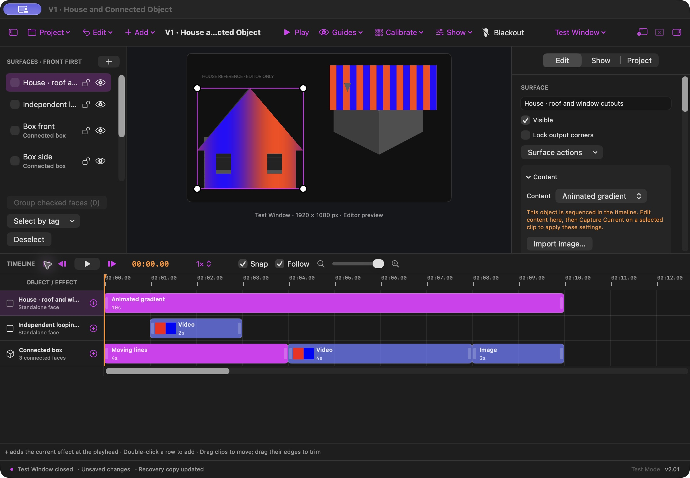
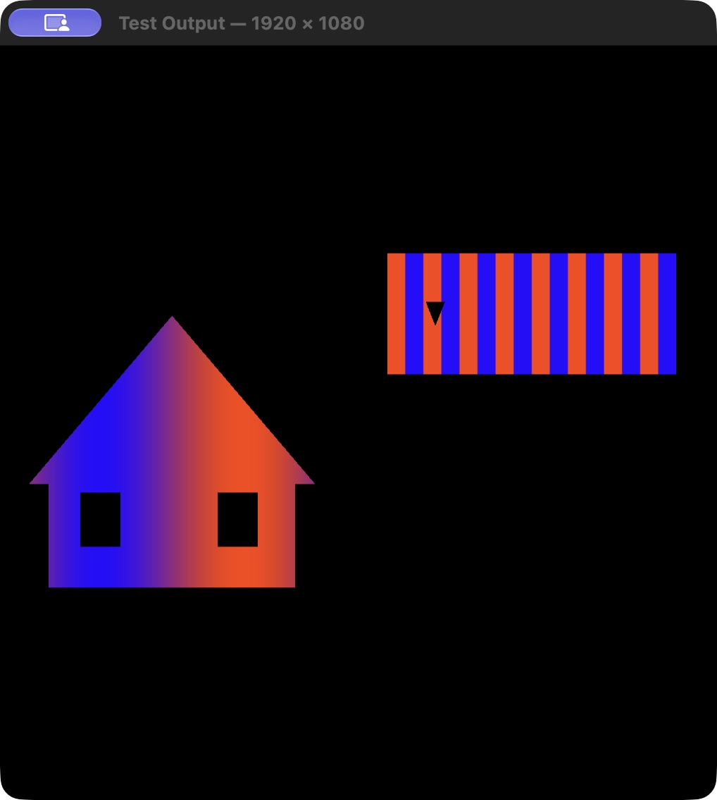
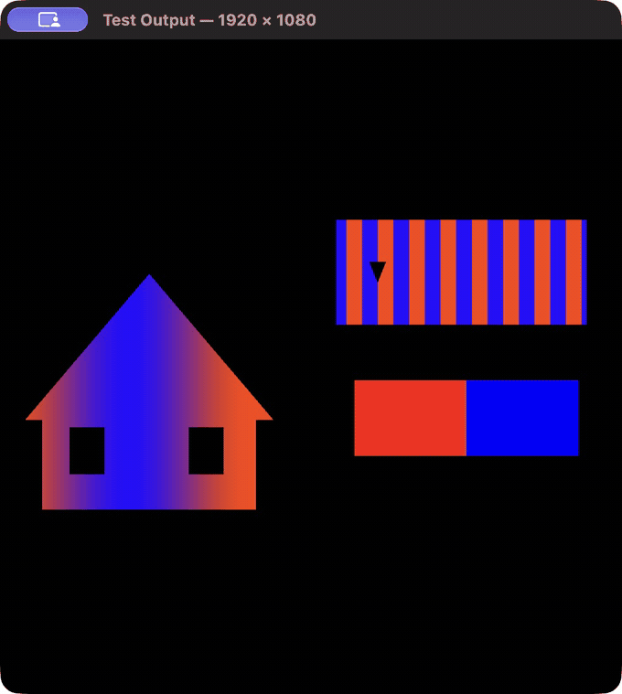

**A native Mac editor for projection mapping, connected surfaces, and timed visual effects.**
Shape your canvas, bring it to life with effects and media, and rehearse in a separate Test Window.

<p>
  <a href="https://github.com/Chosencode25/projection-mapper/releases/download/v1.15.1/ProjectionMapper-v1.15.1-macOS-universal.zip"></a>
  <a href="docs/BUILD_AND_RUN.md"></a>
</p>

macOS **15+** · Apple Silicon + Intel builds · SwiftUI, AppKit & Metal

[Getting started](docs/GETTING_STARTED.md) · [User guide](docs/V1_USER_GUIDE.md) · [Keyboard shortcuts](#keyboard-shortcuts) · [Documentation](docs/README.md) · [Roadmap](docs/V2_ROADMAP.md) · [Report a bug](https://github.com/Chosencode25/projection-mapper/issues/new/choose)

## Your workspace, your output

<table>
  <tr>
    <td width="70%"><a href="assets/github/editor.png"></a></td>
    <td width="30%"><a href="assets/github/test-output.png"></a></td>
  </tr>
  <tr><td><b>Edit and sequence.</b> Keep surfaces, content, and timing in one workspace.</td><td><b>Rehearse separately.</b> Inspect clean output while keeping the editor available.</td></tr>
</table>

Screenshots and the demo below were captured from build 14. Build 16 adds the newer workspace controls and keyboard editing.

<details>
<summary><b>Watch the demo</b> — a short capture of Test Mode playback</summary>

<p align="center"></p>

Captured from the actual v2.01 app using project-owned demo media. This shows Test Mode playback, not a physical projection or a frame-rate benchmark.

</details>

## What you can make

| Feature | In your workflow |
|---|---|
| **Surface mapping** | Position corners, shape polygon masks, and cut out windows or other details. |
| **Connected objects** | Give multiple faces one content canvas, with Continuous and Repeat modes. |
| **Effects and media** | Mix built-in animations, images, and video; reuse looks and palettes. |
| **Visual timeline** | Capture content into clips, trim and move them, then scrub and rehearse. |
| **Keyboard editing** | Space to play/pause, contextual duplicate/delete, clip nudging and a searchable shortcut reference. |
| **Portable projects** | Save referenced media with your layout, with undo/redo and recovery. |
| **Test Mode** | Use a resizable output window that shares the editor's renderer and timing. |

## Keyboard shortcuts

**Latest source: v2.01/build 16.** Space plays/pauses in the editor and clean output
windows. Use **Command-/** to open the searchable reference inside the app.

| Start here | Shortcut |
|---|---|
| Play / Pause | **Space** or **⌘↩** |
| Stop and return to beginning | **⇧⌘↩** |
| Duplicate selection | **⌘D** |
| Delete selected clip, face, object or mask point | **Delete** |
| Split selected video at playhead | **⌘B** |
| Fit complete timeline | **⌘0** |

[Open the full shortcut guide →](docs/KEYBOARD_SHORTCUTS.md)

<details>
<summary><b>All keyboard shortcuts</b> — playback, editing, timeline, files, panels and output</summary>

**Key:** ⌘ Command · ⌥ Option · ⌃ Control · ⇧ Shift · ↩ Return · ⌫ Delete.
The v1.15.1 download has an earlier shortcut set; these tables describe build 16.

### Playback

| Action | Shortcut |
|---|---|
| Play / Pause | **Space / ⌘↩** |
| Stop and Return to Beginning | **⇧⌘↩** |
| Step Back 1/30 Second | **⌥←** |
| Step Forward 1/30 Second | **⌥→** |
| Step Back One Second | **⌥⇧←** |
| Step Forward One Second | **⌥⇧→** |
| Go to Beginning | **Home (fn-←)** |
| Go to Sequence End | **End (fn-→)** |

### Surfaces and objects

| Action | Shortcut |
|---|---|
| Add Surface | **⇧⌘N** |
| Duplicate Selection | **⌘D** |
| Delete Selection | **Delete / ⌘⌫** |
| Deselect | **⇧⌘A** |
| Group Faces | **⌘G** |
| Ungroup Selected Object | **⇧⌘G** |
| Lock / Unlock Geometry | **⌘L** |
| Show / Hide Selection | **⇧⌘H** |
| Bring Face Forward | **⌘]** |
| Send Face Backward | **⌘[** |
| Select Previous Surface | **⌥⌘↑** |
| Select Next Surface | **⌥⌘↓** |

### Media imports

| Action | Shortcut |
|---|---|
| Import Image as New Surface… | **⇧⌘I** |
| Import Video as New Surface… | **⌥⌘I** |

### Timeline

| Action | Shortcut |
|---|---|
| Add Current Content at Playhead | **⇧⌘K** |
| Apply Edited Content to Selected Clip | **⌥⌘K** |
| Split Selected Video Clip at Playhead | **⌘B** |
| Move Clip Earlier by 0.1 Seconds | **⌥⌘←** |
| Move Clip Later by 0.1 Seconds | **⌥⌘→** |
| Move Clip Earlier by One Second | **⌥⇧⌘←** |
| Move Clip Later by One Second | **⌥⇧⌘→** |
| Zoom In on Timeline | **⌘=** |
| Zoom Out on Timeline | **⌘-** |
| Fit Complete Timeline | **⌘0** |
| Reveal Playhead | **⇧⌘P** |
| Toggle Timeline Snapping | **⌥⌘S** |
| Toggle Follow Playhead | **⌥⌘F** |

### Inspectors

| Action | Shortcut |
|---|---|
| Edit Inspector | **⌥⌘1** |
| Show Inspector | **⌥⌘2** |
| Project Inspector | **⌥⌘3** |

### Output and audio

| Action | Shortcut |
|---|---|
| Close Output | **⌃⌘W** |
| Mute Video Audio | **⇧⌘M** |

### Files and history

| Action | Shortcut |
|---|---|
| New project | **⌘N** |
| Open project | **⌘O** |
| Save project | **⌘S** |
| Save project as | **⇧⌘S** |
| Undo project edit / native text undo while typing | **⌘Z** |
| Redo project edit / native text redo while typing | **⇧⌘Z** |

### Panels, guides and windows

| Action | Shortcut |
|---|---|
| Show / hide sidebar | **⌃⌘S** |
| Show / hide inspector | **⌃⌘I** |
| Show / hide timeline | **⌃⌘T** |
| Show editor window | **⌃⌘E** |
| Show / hide editor handles | **⌃⌘H** |
| Show / hide face and object names | **⌃⌘L** |
| Enter / exit calibration grid | **⌃⌘C** |
| Open selected output explicitly | **⌃⌘O** |
| Immediate visual blackout | **⇧⌘B** |
| Restore visual output | **⇧⌘R** |
| Open searchable Keyboard Shortcuts reference | **⌘/** |

### Direct editing and standard Mac keys

| Action | Shortcut |
|---|---|
| Nudge selected corner or object handle | **Arrow keys** |
| Nudge with a larger step | **Shift + Arrow keys** |
| Cancel mask drawing/grouping, exit mask editing, then clear clip/corner/face selection in stages | **Escape** |
| Close focused physical projector output | **Escape** |
| Cut / copy / paste / select all in text fields | **⌘X / ⌘C / ⌘V / ⌘A** |
| Close current window / quit app | **⌘W / ⌘Q** |

### How selection and typing work

- Space works in the editor, Test Output and focused projector output. Normal typing retains spaces, Delete, arrow navigation and native text undo; editor actions are suspended in text fields, sheets and modal dialogs.
- Duplicate/Delete follow the selected clip, face or object. Selecting a face in the canvas/sidebar clears the old clip selection. Selecting a timeline track exits mask editing.
- In mask mode, Delete removes the selected point or last draft point, never the whole face. Existing minimum-point and geometry-lock guards remain enforced.
- Holding Space/Delete does not repeatedly toggle playback or delete successive faces. Arrow nudges require the selected corner/object handle to have keyboard focus.
- Command-G opens grouping; check faces, then Command-G creates the object. Shift-Command-G ungroups the selected object.
- Option-arrows pause and seek by a nominal 1/30 second; Shift-Option-arrows step one second. These are time steps, not decoded-video-frame guarantees.
- Video split requires at least 0.1 seconds on each side of the playhead and preserves source position, rate and loop phase. Procedural effect clips cannot be split because their saved format has no phase offset.
- Clip moves and duplication obey the existing overlap/range checks and undo history. New shortcut actions never bypass explicit output opening or enable audio automatically. Visual blackout and audio mute remain separate.
- Surface/object clipboard cut/paste, ripple editing, music waveforms and crossfades are not implemented by these shortcuts.

</details>

## Choose your version

| | Downloadable release | Latest source |
|---|---|---|
| **Version** | [v1.15.1 / build 13](https://github.com/Chosencode25/projection-mapper/releases/tag/v1.15.1) | [v2.01 / build 16](docs/BUILD_AND_RUN.md) |
| **Output** | Resizable Test Window | Test Window + explicit external fullscreen output |
| **Use it** | [Download the universal app](https://github.com/Chosencode25/projection-mapper/releases/download/v1.15.1/ProjectionMapper-v1.15.1-macOS-universal.zip) | Build with **Xcode 27.0 beta 5 (27A5237l)** |

The latest source passed **312 correctness checks in both Debug and Release** on the recorded Apple Silicon test host. These are local automated checks, not hosted CI. [Verification and exclusions →](docs/LOCAL_SHORTCUTS_VERIFICATION.md)

**Current limits:** physical projector and optical timing acceptance remain pending. Listening/device-loss and Intel/older-macOS runtime acceptance are also pending. Builds are locally ad-hoc signed; Developer ID signing and notarization are not established. Music sequencing, advanced choreography, and the phone editor are on the [V2 roadmap](docs/V2_ROADMAP.md).

## Get started

1. Download the release, extract it, and move **ProjectionMapper.app** to Applications.
2. Open **Help → Open V1 Demo** to explore an unsaved copy of the included project.
3. Select a face, inspect its mapping and content, then open **Test Output** and press Play.

[Full getting-started guide →](docs/GETTING_STARTED.md)

## Build and contribute

```sh
git clone https://github.com/Chosencode25/projection-mapper.git
cd projection-mapper
python3 app/scripts/project.py doctor
python3 app/scripts/project.py build
```

Use the exact pinned Xcode build. The helper keeps generated files in one disposable cache; the native interface is entirely SwiftUI and programmatic AppKit.

[Build & test](docs/BUILD_AND_RUN.md) · [Contributing](CONTRIBUTING.md) · [Feature requests](https://github.com/Chosencode25/projection-mapper/issues/new/choose) · [Changelog](CHANGELOG.md)

<details>
<summary>Project history and maintenance</summary>

[Development requirements](docs/PROJECT_DEVELOPMENT.md), [progress](docs/PROGRESS.md), [GitHub workflow](docs/GITHUB_WORKFLOW.md), and [cleanup records](docs/PROJECT_CLEANUP_2026-10-19.md) retain detailed milestone evidence. Published releases and tags are preserved. [Documentation index →](docs/README.md)

</details>
